# To the Power of Math: A Serverless Web App on AWS

A small full-stack serverless project built on AWS. A user enters a **base** and an **exponent** on a web page, the app calculates `base ^ exponent`, shows the answer in the browser, and stores the result in a database.

I built this hands-on to practice connecting five core AWS services into one working application, including the IAM permissions and CORS configuration that real projects need.

## Architecture

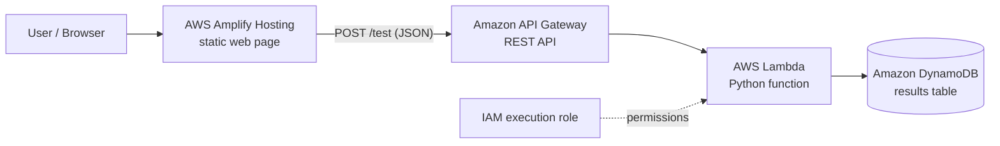

| Service | Role in the project |
|---|---|
| **AWS Amplify Hosting** | Hosts the front-end page (`index.html`) |
| **Amazon API Gateway** | Public REST endpoint (`POST`) that the page calls; CORS enabled |
| **AWS Lambda** | Python function that calculates the power and writes to the database |
| **Amazon DynamoDB** | Stores each result with a timestamp |
| **AWS IAM** | Least-privilege inline policy that lets Lambda write to the one table |

**Region:** Asia Pacific (Mumbai), `ap-south-1`

## How it works

1. The user types a base and an exponent and clicks **CALCULATE**.
2. JavaScript in `index.html` sends a `POST` request with `{"base": ..., "exponent": ...}` to the API Gateway stage URL.
3. API Gateway invokes the Lambda function.
4. Lambda converts the inputs to integers, calculates the result with `math.pow`, and saves the result and the current UTC time to DynamoDB.
5. Lambda returns `{"statusCode": 200, "body": "Your result is <n>"}` and the page shows the body in an alert.

## Repository structure

```
.
├── frontend/
│   └── index.html                  # Web page + JavaScript that calls the API
├── backend/
│   ├── lambda_function.py          # Final Lambda code (calculates and writes to DynamoDB)
│   ├── lambda_function_original.py # First version (calculation only, no database)
│   └── iam-policy.json             # Inline IAM policy for the Lambda role
├── docs/
│   └── screenshots/                # Console screenshots of the finished build
└── README.md
```

## Screenshots

### Data layer: DynamoDB
Table `PowerofMathDB` with partition key `ID` (String), on-demand capacity.

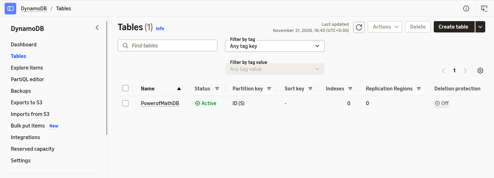
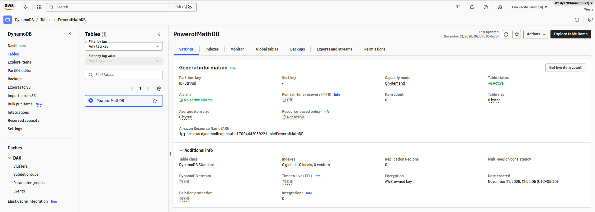

### Permissions: IAM
The Lambda execution role has the standard basic-execution policy plus a custom inline policy (`PowerofMathDynamo`) that allows only the DynamoDB actions the function needs.

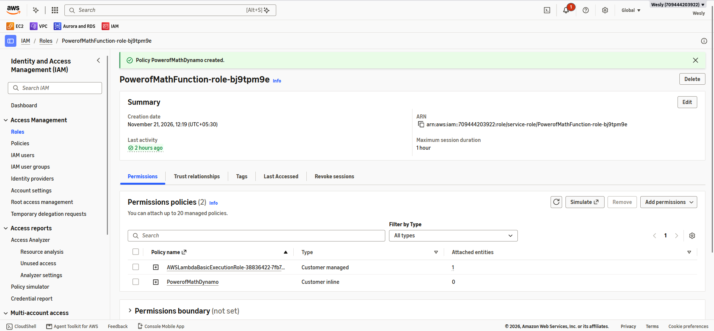

### Compute: Lambda
The function with an API Gateway trigger, and a successful test run (`base = 2`, `exponent = 4` returns `16.0`).

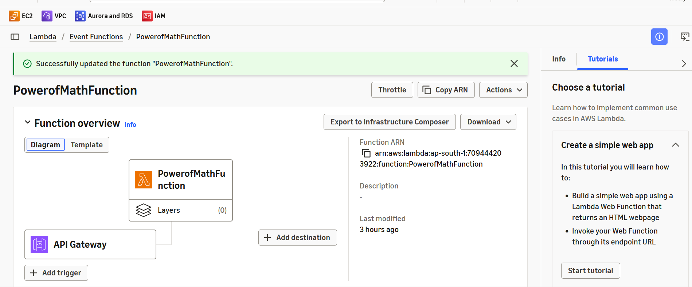
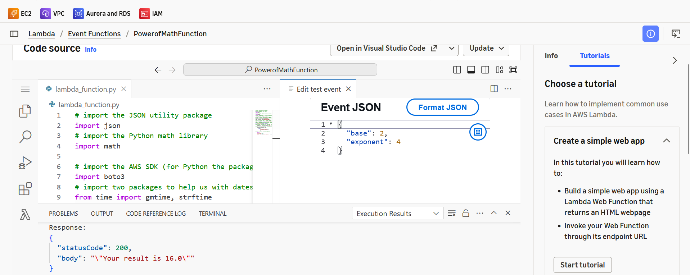

### API layer: API Gateway
A REST API with a `POST` method (Lambda integration) and an `OPTIONS` method (used for the browser's CORS preflight).

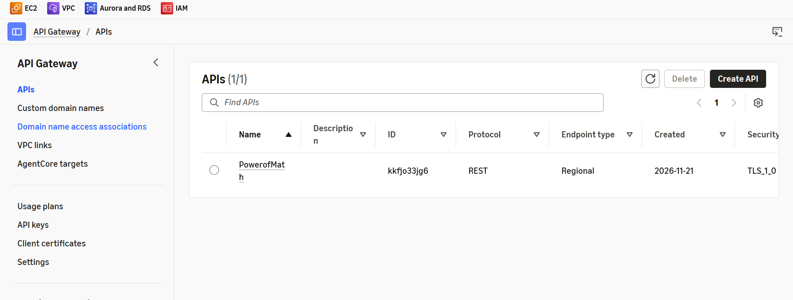
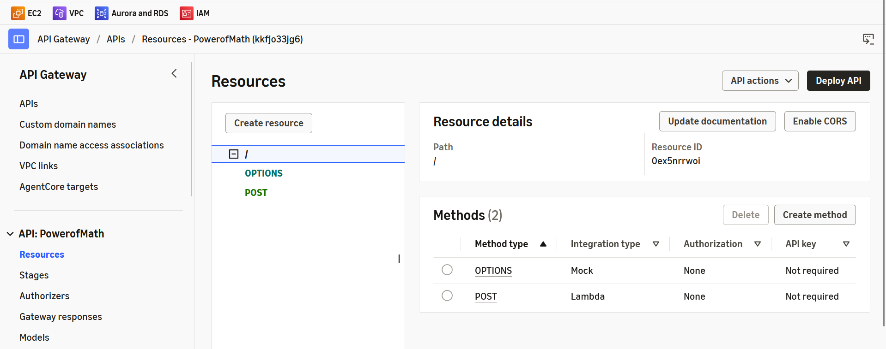
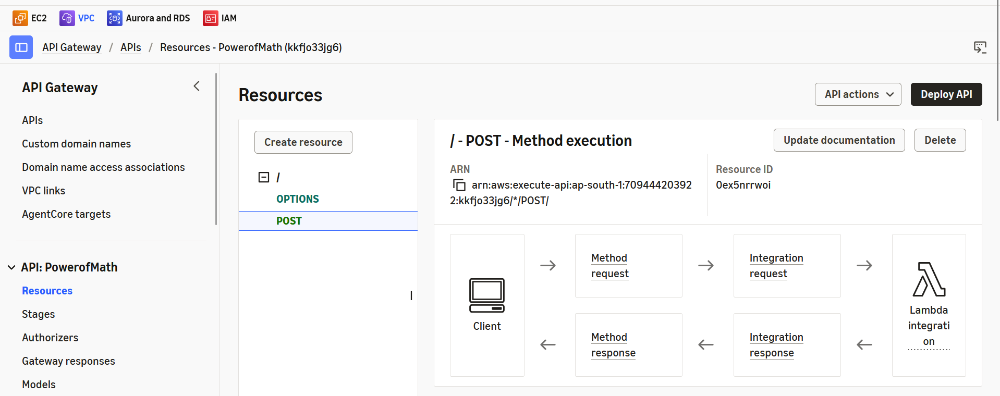

### Front end: Amplify Hosting
The page deployed to an Amplify Hosting branch.

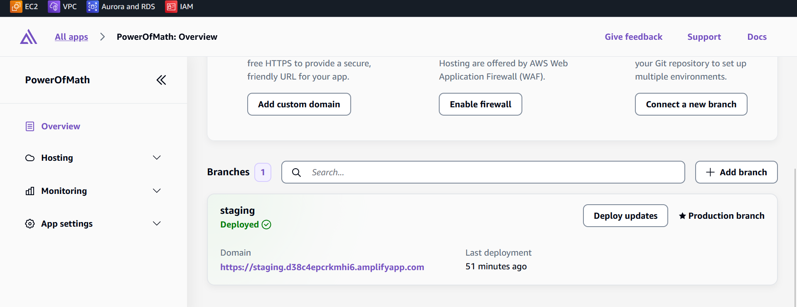

### Result: data stored from the web page
Items written to DynamoDB after using the deployed page. Each item holds the calculated result (`ID`) and the time it was saved (`LatestGreetingTime`).

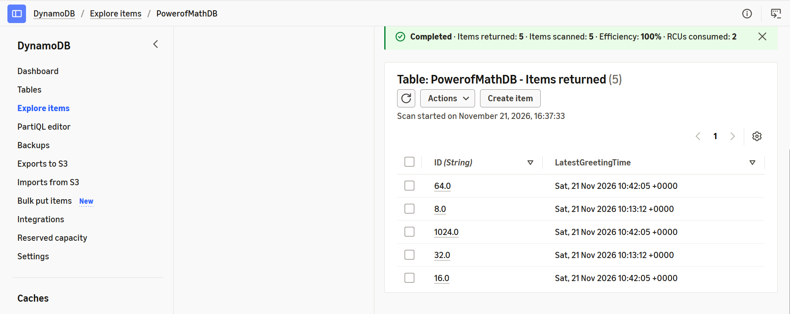

## Build it yourself

All steps are done in the AWS Console. Use the same region for every service.

1. **DynamoDB**: create a table named `PowerofMathDB` with partition key `ID` (String) and on-demand capacity.
2. **Lambda**: create a Python function named `PowerofMathFunction`. Paste in `backend/lambda_function.py`, make sure the table name in `dynamodb.Table('...')` matches your table, and click **Deploy**.
3. **IAM**: open the function's execution role and add an inline policy using `backend/iam-policy.json`. Replace `YOUR-TABLE-ARN` with your table's ARN (shown on the table's details page).
4. **Test the Lambda** with this event. You should get `Your result is 16.0`, and a new item should appear in DynamoDB:
   ```json
   {"base": 2, "exponent": 4}
   ```
5. **API Gateway**: create a REST API with a `POST` method on the root resource that integrates with the Lambda function. Choose **Enable CORS** and select Default 4XX, Default 5XX, `OPTIONS`, `POST` and origin `*`. Then click **Deploy API** to a stage named `test`.
6. **Front end**: in `frontend/index.html`, replace the URL inside `fetch(...)` with your stage's **Invoke URL**. Zip the file (with `index.html` at the top level) and deploy it with **AWS Amplify Hosting**.
7. Open the Amplify URL, enter two numbers, click **CALCULATE**, and check the table under **Explore items** in DynamoDB.

## Problems I hit and how I solved them

| Symptom | Cause | Fix |
|---|---|---|
| Testing inside the API Gateway console worked, but the web page did nothing | Browsers enforce CORS; the console test does not | Enable CORS on the resource (`POST` and `OPTIONS`), then redeploy the API |
| CORS or API changes had no effect | API Gateway changes only go live after a deployment | Click **Deploy API** to the stage after every change |
| Lambda could not write to DynamoDB | The execution role had no DynamoDB permissions | Attach a scoped inline policy for the table |
| Number inputs failed in `math.pow` | A text box sends values as strings | Convert with `int()` in the Lambda code |
| Test tab was missing in the API Gateway console | The new console moved Test below the method diagram | Scroll down under the diagram and open the **Test** tab |

## Known limitations and possible improvements

- **Timestamp is computed once per container.** In `lambda_function.py`, `now = strftime(...)` runs at the top of the file, so warm invocations reuse the same time (you can see matching timestamps for different results in screenshot 10). Moving that line inside `lambda_handler` fixes it.
- **The result is the partition key**, so the same result (for example `16.0`) overwrites the earlier item instead of adding a new one. Using a unique ID (for example a UUID) as the key would turn the table into a full request log.
- **No input validation.** Non-numeric input causes a Lambda error. Validate the input and return a `400` response.
- **CORS allows any origin (`*`).** Restrict it to the Amplify domain for production use.
- **No authentication on the API.** Add an API key, a Cognito authorizer, or throttling via a usage plan.
- **Infrastructure is built by hand.** The next step would be to define everything with AWS SAM, CloudFormation or Terraform.

## Cleanup

After finishing the project I deleted the AWS resources I created (Amplify app, API, Lambda function, DynamoDB table and IAM policy) to avoid ongoing charges, so the original URLs no longer work. If you build this yourself, do the same when you are done.

## Credits

Built while following a YouTube tutorial on creating a serverless web app with AWS Amplify, API Gateway, Lambda and DynamoDB. The architecture, deployment, debugging and write-up are my own hands-on work.
